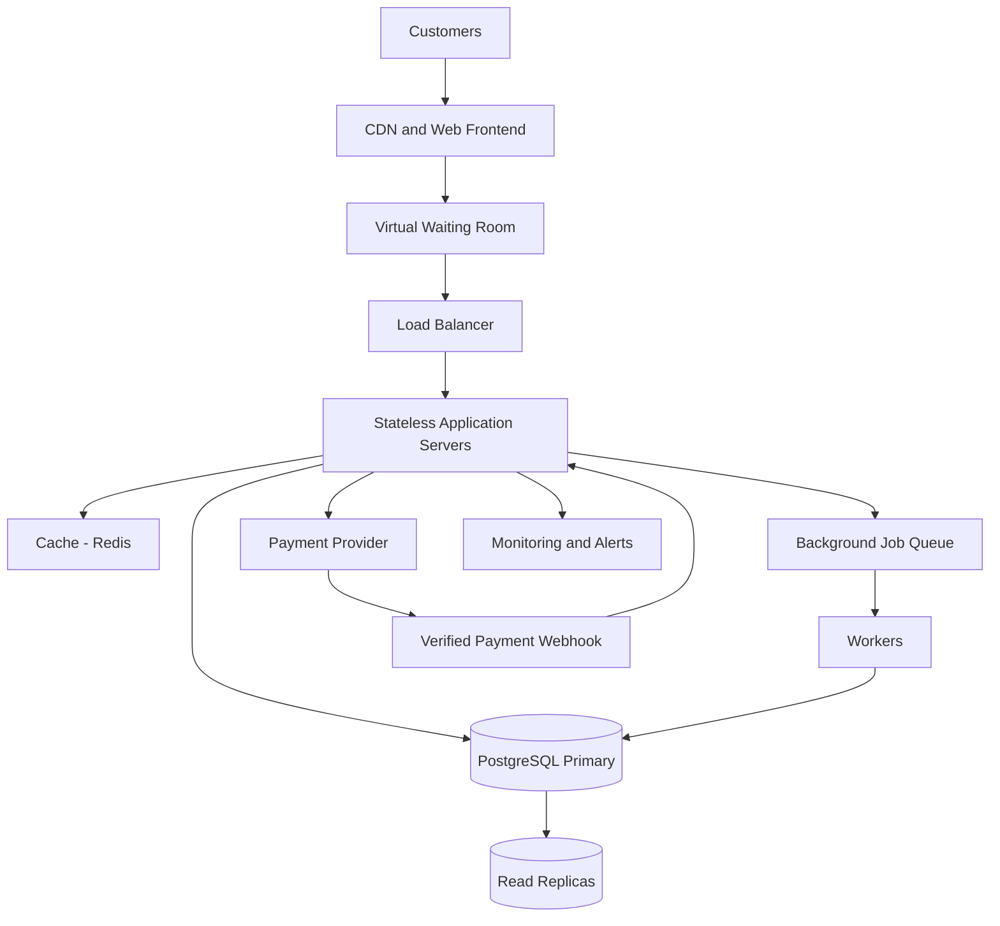

# TicketHub — System Design

## 1. Context, Requirements and Scope

### Context

TicketHub is a website where users can discover concerts and events, view available seats, purchase tickets and access their confirmed bookings. It serves 2 million registered users.

The main design challenge is handling a very popular concert sale fairly and reliably without selling the same seat to two people.

### Functional requirements

- Users can register, sign in and view events.
- Users can view event details, ticket prices and available seats.
- Users can temporarily hold available seats while completing checkout.
- Users can pay for their orders and receive confirmed tickets.
- Users can view their purchased tickets and order history.
- Users can see when seats are unavailable or their reservation expires.

### Non-functional requirements

- **Speed:** Event pages should load quickly, with a target of under 2 seconds for typical requests under normal conditions.
- **Correctness:** A seat must never be sold to two different customers.
- **Availability:** Users should still be able to browse events during high traffic. Checkout must fail safely if essential services are unavailable.
- **Fairness:** Seat allocation should follow a consistent first-come, first-served policy based on successful seat holds. Users must not be able to reserve the same seat repeatedly to bypass other buyers.
- **Security:** Authentication, authorization, input validation and secure payment processing must protect users and transactions.
- **Scalability:** The system must handle sudden traffic increases during popular ticket sales.
- **Reliability:** Payment retries and duplicate requests must not create duplicate orders or charges.

### Goals and non-goals

**Goals:** Reliable event browsing, temporary seat reservations, safe payments and accurate ticket ownership.

**Non-goals:** Building a social network, streaming concert videos or implementing a resale marketplace in the first version.

## 2. Traffic and Storage Estimates

### Given facts

- Registered users: 2,000,000
- Normal daily visitors: 50,000
- Pages viewed per visitor: 10
- Normal daily ticket sales: 5,000
- Popular-sale demand: 200,000 people competing for 20,000 seats in 10 minutes

### Normal traffic

Daily page views:

50,000 × 10 = 500,000 page views per day.

Average page views per second:

500,000 ÷ 86,400 ≈ 5.8 page views per second.

Normal ticket sales average:

5,000 ÷ 86,400 ≈ 0.058 tickets per second, or approximately 208 tickets per hour.

These are daily averages. Actual traffic will vary throughout the day.

### Popular concert sale

Average prospective buyer arrival rate:

200,000 ÷ 600 seconds ≈ 333 buyers per second.

Seat demand:

200,000 people ÷ 20,000 seats = 10 people competing per seat on average.

If each buyer generates five API requests during the sale, the average incoming request rate would be approximately:

333 × 5 = 1,665 requests per second.

This five-request assumption is for capacity planning, not a measured fact. Actual traffic depends on browsing behaviour, retries and checkout steps. The system must also be tested against bursts above the average.

### Comparison and capacity strategy

Normal browsing averages about 5.8 page views per second, while the assumed big-sale workload could generate around 1,665 API requests per second. These figures measure different things, so they should not be compared as identical request types.

I would use a CDN and cache for public event information, horizontally scalable application servers, a queue or virtual waiting room for sale traffic, and a transactional database for seat reservations and orders.

## 3. API Design

All endpoints use HTTPS and JSON. Authenticated endpoints require a valid user session or access token.

| Method and endpoint | Purpose | Expected response |
|---|---|---|
| GET /api/events | Browse published events | 200 OK with event list |
| GET /api/events/:eventId | View event details | 200 OK or 404 Not Found |
| GET /api/events/:eventId/seats | View seat availability and prices | 200 OK with seat list |
| POST /api/seat-holds | Temporarily reserve seats | 201 Created or 409 Conflict |
| DELETE /api/seat-holds/:holdId | Release a user's hold | 204 No Content |
| POST /api/orders | Create an order from a valid hold and initiate checkout | 201 Created or 409 Conflict |
| POST /api/payments/webhook | Receive verified payment-provider updates | 200 OK after safe processing |
| GET /api/me/tickets | View the signed-in user's tickets | 200 OK |

### Example seat-hold request

POST /api/seat-holds

Request body:

    {
      "eventId": "event-123",
      "seatIds": ["A-10"],
      "idempotencyKey": "unique-request-456"
    }

The server verifies the user's identity, validates the requested seats and attempts to hold them in a database transaction.

A successful response includes the hold ID and expiry time. If another user already holds or has purchased the seat, the API returns `409 Conflict`.

The client must not be trusted to declare a seat available or a payment successful.

## 4. Data Model

The initial design uses a relational database such as PostgreSQL because seat ownership and orders require reliable transactions, relationships and uniqueness constraints.

### Tables

#### users

- `id` — primary key
- `name` — user's name
- `email` — unique email address
- `password_hash` — securely hashed password, if password authentication is used
- `created_at` — account creation time

#### events

- `id` — primary key
- `title` — event name
- `venue` — event location
- `starts_at` — event date and time
- `status` — draft, published or cancelled
- `created_at` — record creation time

#### seats

- `id` — primary key
- `event_id` — foreign key referencing `events.id`
- `seat_label` — visible seat identifier, such as A-10
- `price` — ticket price
- `status` — available, held or sold

Constraint: `UNIQUE(event_id, seat_label)` ensures that a seat label is defined only once per event.

#### orders

- `id` — primary key
- `user_id` — foreign key referencing `users.id`
- `status` — pending, confirmed, failed or cancelled
- `total_amount` — order total
- `payment_reference` — unique payment-provider transaction reference, where available
- `idempotency_key` — unique key to prevent duplicate order creation for a retried request
- `created_at` — order creation time

#### order_items

- `id` — primary key
- `order_id` — foreign key referencing `orders.id`
- `seat_id` — foreign key referencing `seats.id`
- `price_at_purchase` — price recorded when the order was created

Constraint: `UNIQUE(seat_id)` prevents a seat from appearing in more than one successful order item. The constraint must be enforced by the database, not just by application code.

#### seat_holds

- `id` — primary key
- `user_id` — foreign key referencing `users.id`
- `seat_id` — foreign key referencing `seats.id`
- `expires_at` — time the temporary hold expires
- `status` — active, converted or released

An active hold must be unique per seat. This can be enforced using a partial unique index for active holds, alongside transactional locking and expiry handling.

### Relationships

- One user can create many orders.
- One event has many seats.
- One order contains one or more order items.
- Each order item refers to one seat.
- A seat can have at most one active hold and can be sold only once.

## 5. Preventing Double-Booking

The database is the final authority on seat ownership. Checking availability only in application code is not sufficient because two requests can check the same seat at nearly the same time.

### Seat-hold process

1. A user requests a hold on a seat.
2. The application starts a database transaction.
3. The transaction locks the relevant seat row, for example using `SELECT ... FOR UPDATE`.
4. The server checks that the seat is not sold and that any previous hold has expired or been released.
5. If available, the server creates an active hold with a short expiry time, such as five minutes, and commits the transaction.
6. A competing request must wait for the lock or discover that the seat is already held. It receives a conflict response rather than another successful hold.

Expired holds must be treated as expired during the transaction. A background worker can clean up expired records, but correctness must not depend on that worker running exactly on time.

### Payment and confirmation

- Payment is initiated only for a valid hold.
- The payment provider processes the payment securely.
- A verified payment notification is processed idempotently, so duplicate notifications do not create duplicate confirmations.
- A transaction confirms the order, records the order items and marks the seats as sold.
- Unique constraints and row locking protect against conflicting sales.
- If payment fails or the hold expires, the order must not be confirmed. The system must reconcile late payment success with the reservation state and refund or otherwise resolve payments that cannot be fulfilled.

The database transaction must never remain open while waiting for an external payment provider. Payment and reservation expiry need an explicit state-transition and recovery process.

**Key principle:** Row locks serialize competing attempts, transactions keep related changes consistent, and database constraints provide a final safeguard against duplicate ownership.

## 6. High-Level Architecture

### Component explanations

- **CDN and web frontend:** Delivers static files and caches public content close to users.
- **Virtual waiting room:** Limits the number of users entering the high-contention checkout flow and gives users a fair, orderly queue.
- **Load balancer:** Distributes incoming requests across healthy application servers.
- **Stateless application servers:** Validate requests and implement business rules. Session state is stored in shared infrastructure rather than individual servers, allowing servers to be added or replaced.
- **Redis cache:** Stores frequently requested public event information and other safe-to-cache data. Seat availability must be revalidated against the database before a hold is accepted.
- **PostgreSQL primary:** Stores authoritative seat, hold, order and payment-related state. Transactions and constraints protect correctness.
- **Read replicas:** Handle suitable read-heavy queries, such as browsing event information. They are not the authority for deciding whether a seat can be sold.
- **Background job queue and workers:** Handle expiry cleanup, notifications, retries and reconciliation without blocking user requests.
- **Payment provider and webhook:** Process payments externally and report results through verified notifications.
- **Monitoring and alerts:** Track latency, error rates, database contention, queue length, payment failures and remaining capacity.

### How the architecture handles a big sale

The CDN and cache reduce repeated requests to the database. The waiting room limits checkout concurrency and smooths traffic bursts. The load balancer distributes requests across multiple application servers. Read replicas support browsing, while the primary database serializes competing seat reservations.

Autoscaling can add application servers, but it cannot create more seats or eliminate database contention by itself. The waiting room and transaction design are therefore essential.

## 7. Trade-offs

### Trade-off 1: Strict seat correctness versus checkout throughput

Locking seat rows and using database transactions can increase wait times when many users compete for the same seats. However, allowing concurrent unchecked writes risks selling a seat twice. TicketHub prioritizes correctness and uses a waiting room to limit contention.

### Trade-off 2: Caching versus fresh availability

Caching event descriptions and public information improves speed and reduces database load. However, cached seat availability may become stale. Therefore, the seat list is informational; the database must validate every hold request.

### Trade-off 3: Waiting room versus immediate access

A virtual waiting room can make the sale fairer and protect the checkout service, but users may have to wait even when some seats remain available. Queue admission should be rate-limited and transparent, with consistent rules for everyone.

### Trade-off 4: Relational database versus a distributed datastore

A relational database offers transactions, constraints and clear ownership rules, making it a strong starting point for ticket sales. A highly distributed datastore may offer greater geographic scale, but coordinating exclusive seat ownership becomes more complex. I would start with PostgreSQL and scale or partition only when measured bottlenecks justify it.

## 8. Risks and Open Questions

- How should the waiting room handle refreshes, reconnects and suspected bots?
- What is the exact hold duration, and what happens when payment takes longer?
- Which payment-provider guarantees and webhook retry rules are available?
- What are the required availability target and recovery-time objective?
- How many seats can users reserve per order?
- Load testing must establish actual peak request rates, database capacity and queue admission limits.

## Conclusion

TicketHub is designed around a clear priority: users should be able to browse quickly, but a seat must never be sold twice. Caching, stateless servers, a waiting room and read replicas help with scale. Transactions, row locks, idempotency and database constraints protect the correctness of seat reservations and purchases.
